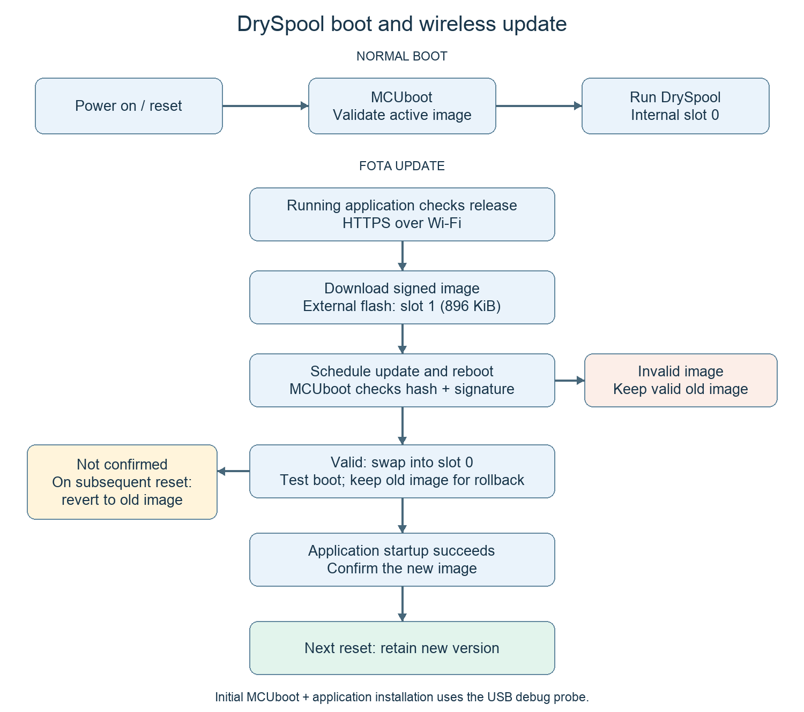
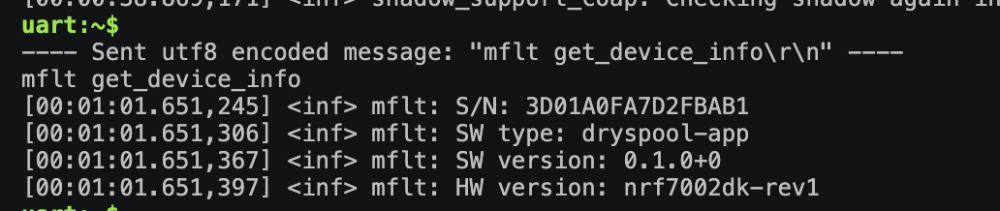
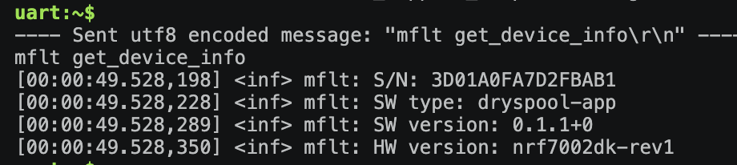

# IoT Venture: Wireless Demo & Secure Firmware Updates

**Team:** T06 — DrySpool\
**Members:** Sirui Wu, Zicong Zhang, Deepa Lokesha\
**Repository:** [DrySpool firmware](https://github.com/ese5180/f26-t06-dry-spool)\
**Platform:** nRF7002 DK, nRF Connect SDK 3.4.0 / Zephyr\
**Verification date:** November 2, 2026\
**Result:** Successful FOTA from `0.1.0+0` to `0.1.1+0` on device `3D01A0FA7D2FBAB1`.

## Q1. Draw and describe your bootloading process

### Boot and update process



MCUboot validates and boots the application. For FOTA, the running application downloads a signed image, stores it in external flash, and reboots. MCUboot validates the candidate and swaps it into the primary slot for a test boot. The application confirms the new image after startup. An unconfirmed image is reverted on a subsequent reset.

The initial bootloader and application are installed through USB. The demonstrated update uses Wi-Fi.

### Bootloader and application sizes

| Component | Size and measurement |
| --- | --- |
| MCUboot | 39,308 bytes; team's documented baseline build, with a 64 KiB partition |
| TF-M secure application | 130,008 bytes; team's documented baseline build |
| Non-secure DrySpool application | 728,024 bytes of flash; local `0.1.1` build with MAC logging |
| Downloaded signed FOTA image | 858,974 bytes; measured in the actual download log |
| Primary / secondary slot | 896 KiB each |

These figures distinguish compiled code, the complete signed update, and reserved storage. The baseline and local builds differ from the downloaded cloud release.

### Who downloads the firmware, and which protocol is used?

The application downloads firmware using **HTTPS over Wi-Fi** through the Memfault/NCS FOTA integration. This reuses the product's Wi-Fi connection without needing a phone. MCUboot validates and installs the downloaded image. Product telemetry separately uses **CoAP/DTLS** to nRF Cloud.

### Where is the firmware stored?

The active image runs from **slot 0 in internal flash**. The candidate is downloaded to **slot 1 in the DK's external MX25R64 QSPI flash**. The external chip has 8 MiB capacity; 896 KiB is allocated to the secondary image slot.

### How are updates secured and failures handled?

Firmware is signed with the team's **ECDSA-P256 private key**. MCUboot uses the corresponding public key to verify the image hash and signature. Signing keys are separate from cloud authentication credentials and are excluded from Git.

- Invalid signatures or corrupted images are rejected.
- An incomplete download is not scheduled for installation.
- An unconfirmed test image is rolled back on a subsequent reset.
- Once confirmed, an image is retained; later defects require a corrective update.

The application calls `boot_write_img_confirmed()` after sensor initialization succeeds. The current sensor backend is simulated, so this is a basic startup check rather than a full hardware health test.

## Q2. Implement FOTA updates on your existing codebase from the Wireless Demo section

### Implementation

FOTA is integrated into the existing DrySpool application, alongside cloud connectivity and product telemetry.

| Requirement | Implementation |
| --- | --- |
| MCUboot | `firmware/Kconfig.sysbuild` enables the bootloader. |
| External flash | Application and bootloader overlays configure the secondary image slot. |
| Custom signing key | `firmware/sysbuild.conf` selects the team's signing key. |
| Wireless download and confirmation | `firmware/coap-fota.conf` and `firmware/src/memfault_fota_support.c` provide FOTA support. |

### 1. Verify the starting version

Before updating, `mflt get_device_info` reported **0.1.0+0**.



### 2. Download and install the cloud release

The following commands checked for and downloaded the release:

```text
mflt get_latest_url
mflt get_latest_release
```

The serial log recorded the complete wireless download, automatic reboot, MCUboot test swap, and application confirmation:

```text
Downloaded 858974/858974 bytes (100%)
MCUBoot image-0 upgrade scheduled. Reset device to apply
FOTA update downloaded, rebooting to apply it
Rebooting in 10s...
Image index: 0, Swap type: test
Starting swap using move algorithm.
Image version: v0.1.1
*** Booting My Application v0.1.1-2d024d1f034c ***
Confirming FOTA update image
```

The downloader fell back from IPv6 to IPv4 and completed successfully. This version transition was performed over Wi-Fi, without USB flashing. Temporary signed download URLs are omitted.

### 3. Verify the updated device

After the update, the same device reported **0.1.1+0**:



It also reconnected to nRF Cloud and uploaded diagnostics:

```text
Authorization result_code: 2.01
Authorized
Connected to nRF Cloud
Data posted successfully, 214 bytes sent
```

A subsequent manual reboot was also completed, and the new version remained installed, as confirmed by the tester.

### 4. Verify the cloud record

The cloud device page shows the same device ID, `3D01A0FA7D2FBAB1`, running **0.1.1+0** with hardware version `nrf7002dk-rev1`.


Together, these results verify the download, installation, version change, cloud reconnection, and persistence after reboot.

**Test scope:** Invalid-signature rejection and faulty-image rollback were not deliberately tested. Sensor readings are simulated. A startup certificate-provisioning warning (`-17`) remained, but the observed FOTA and diagnostic upload succeeded. No serial-recovery extra credit is claimed.

**AI assistance:** AI assisted with source inspection, setup troubleshooting, MAC logging, and report preparation. Results are based on the board's logs, screenshots, and the tester's reboot confirmation.

## Q3. Wireless Demo (in person)

## Q4. Submission Requirements
