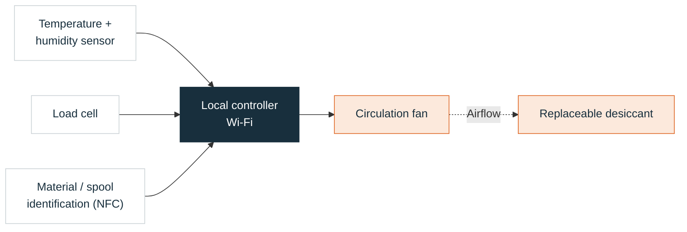
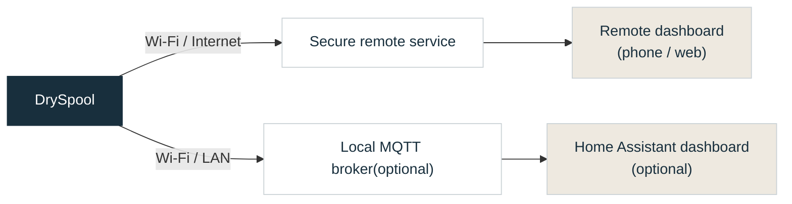

# ESE5180: IoT Venture

**Team Number: T06** 

**Team Name: X** 

| Team Member Name | Email Address                |
| ---------------- | ---------------------------- |
| Sirui Wu         | wu40@engineeringng.upenn.edu |
| Zicong Zhang     | zhang89@seas.upenn.edu       |
| Deepa Lokesh     | deepasr1@engineering.upenn.edu  |

**GitHub Repository URL:** https://github.com/ese5180/X-dryspool

## Concept Development

### Product Function

DrySpool is a proposed connected filament-storage system that monitors remaining filament and alerts users when supplies run low. It measures temperature and humidity and automatically controls a dehumidification module to reduce moisture in the enclosure. RFID/NFC links spools to inventory records, and a dashboard brings together filament, environment, and device status for makerspace users and staff.

### Target Market & Demographics

- **Users:** Students, makers, and staff sharing 3D printers in university laboratories and makerspaces.
- **Purchasers:** Laboratory or makerspace managers responsible for filament supplies and equipment maintenance.
- **Initial market:** U.S. higher-education printing laboratories and makerspaces, with stakeholder outreach in the Philadelphia area.
- **Market estimate:** An illustrative hardware opportunity of $217,000–650,000, based on [NCES&#39;s 3,633 degree-granting institutions in 2022–23](https://nces.ed.gov/pubs2024/2024144.pdf), an assumed 10%–30% adoption scope, four nodes per site, and a hypothetical 149 per node. The 20% base case is approximately 433,000. These are planning assumptions; site eligibility, demand, and pricing remain unvalidated.
- **Initial sales target:** 10 sites × 4 nodes × $149 = 5,960 after prototype validation and product development; this is a planning target, not committed sales.
- **Competitors:** [SpoolEase](https://www.spoolease.io/docs/full-guide/spool-weight-tracking) addresses filament tracking, and [SpoolSense](https://spoolsense.org/) uses NFC for spool identification. DrySpool proposes combining inventory monitoring, humidity control, and shared-space alerts.

### Stakeholders

| Stakeholder                              | Organization / role                | Feedback focus                                                 |
| ---------------------------------------- | ---------------------------------- | -------------------------------------------------------------- |
| **Tex Kang**                       | **UPenn makerspace contact** | Filament handling, useful alerts, and staff/student workflows. |
| **Hive76 staff member or manager** | **Hive76 commu hackerspace** | Shared inventory, spool identification, and maintenance needs. |

Team-reported conversations indicate interest in remaining-filament alerts, humidity-related functions, and RFID identification. These are preliminary qualitative inputs; prototype feedback and willingness to pay remain to be established.

### System-Level Diagrams

Device system:

Filament path: **Spool in box → PTFE outlet → Printer extruder.** The printer pulls the filament; the spool turns freely.

The fan circulates air through replaceable desiccant to support humidity control. This is a proposed arrangement; final components and enclosure layout remain subject to prototype testing.

Wireless data paths:

### Security Requirements Specification

- **SEC-01:** Devices shall accept only trusted, signed firmware updates and handle failed updates safely.
- **SEC-02:** Private signing keys and service credentials shall remain outside the public repository.
- **SEC-03:** Network services shall use authenticated access and protected communication, including TLS certificate verification for cloud connections.

### Hardware Requirements Specification

Specific components, measurement accuracy, enclosure layout, and control thresholds will be refined through prototype testing.

- **HRS-01:** The system shall use course-compatible Nordic hardware and wireless connectivity, with at least two working devices at MVP and four at final.
- **HRS-02:** The hardware shall support remaining-filament estimation for the selected spool and feeding setup, with calibration and observed accuracy documented.
- **HRS-03:** The system shall measure temperature and humidity and support controlled moisture removal. Environmental sensing and control may be shared across spools where practical.
- **HRS-04:** The hardware shall provide suitable power, compatible interfaces, and external Flash for firmware-update staging.

### Software Requirements Specification

- **SRS-01:** Firmware shall use Zephyr / NCS 3.4.x, and each team member shall be able to build and flash the common project.
- **SRS-02:** The system shall associate readings with the correct spool, support manual identification with planned RFID/NFC assistance, and handle spool replacement and unavailable data clearly.
- **SRS-03:** The system shall display filament, environment, and device status on a dashboard and provide basic local alerts. Thresholds and update intervals may be adjusted during testing.
- **SRS-04:** The system shall control humidity using sensor feedback, handle maintenance and sensor faults, and retain essential local functions during network loss.
- **SRS-05:** The system shall support signed wireless updates and course-required cloud diagnostics, including software versions, core dumps, and critical data. Development shall include peripheral-driver TDD and the required CI checks.
