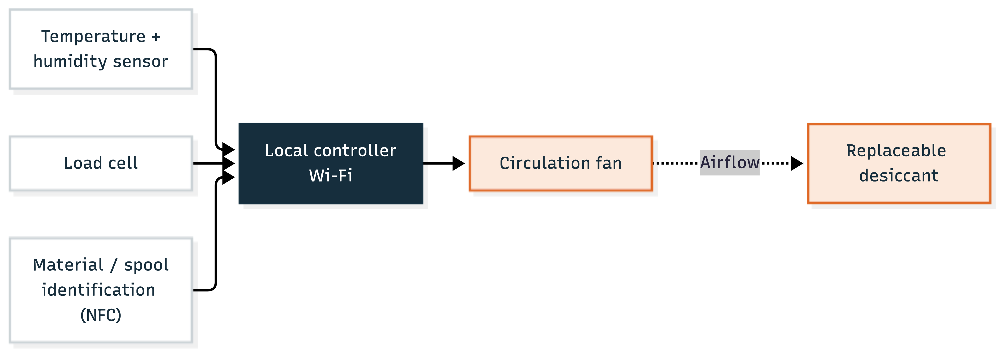
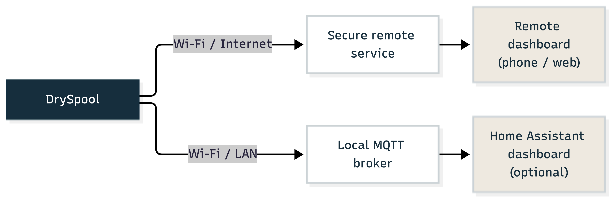
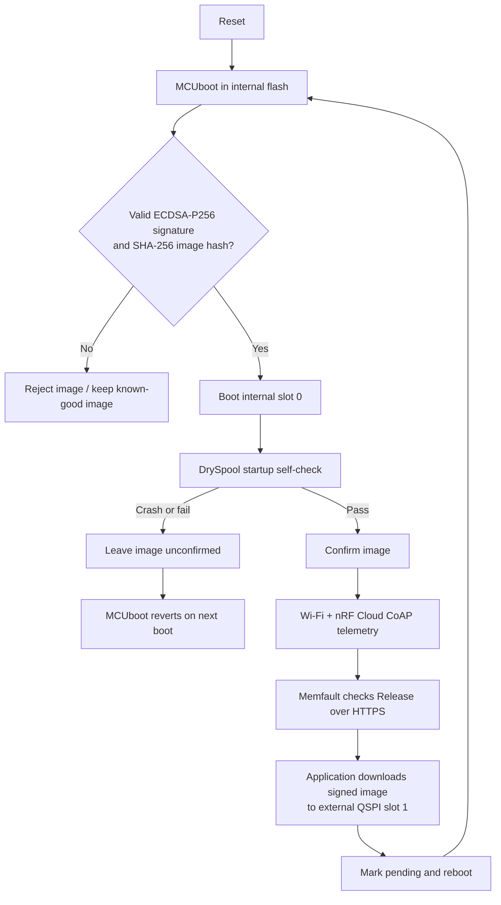
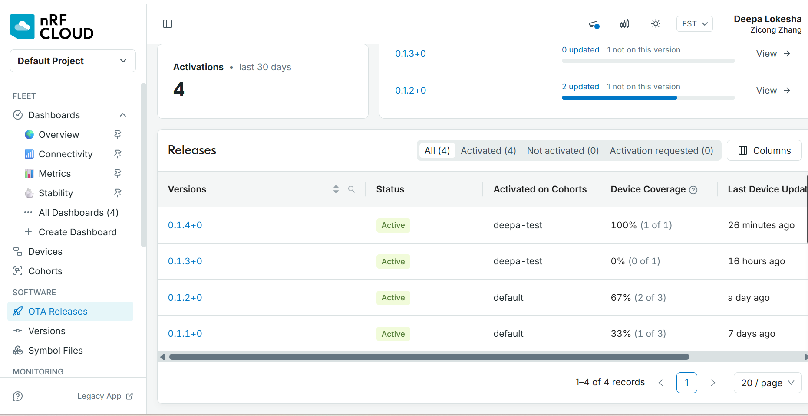
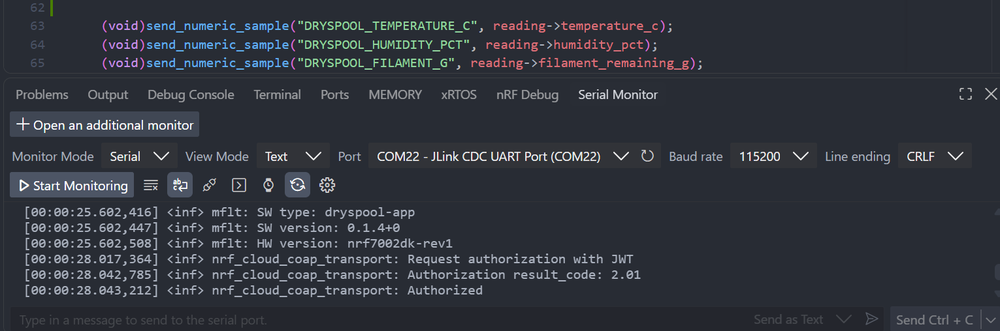
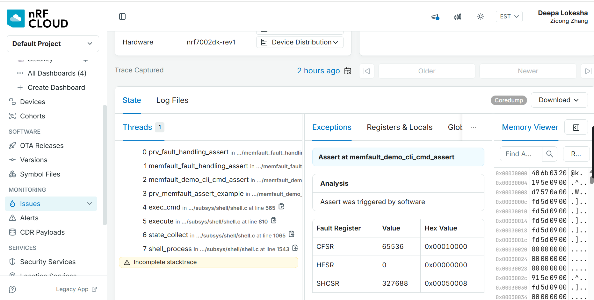
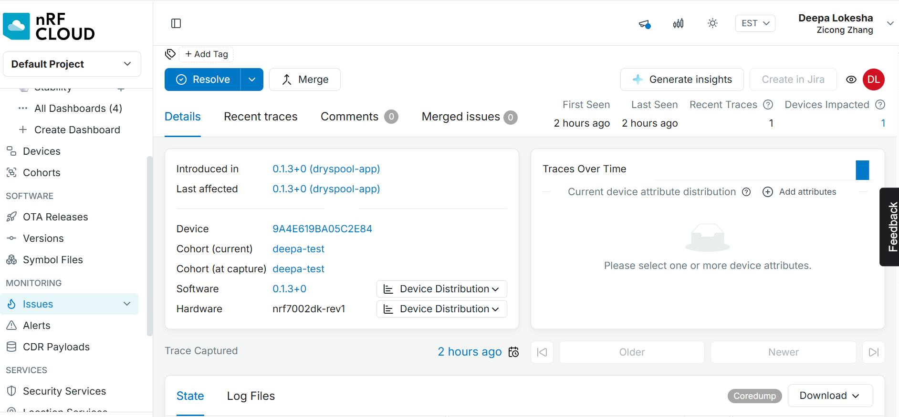
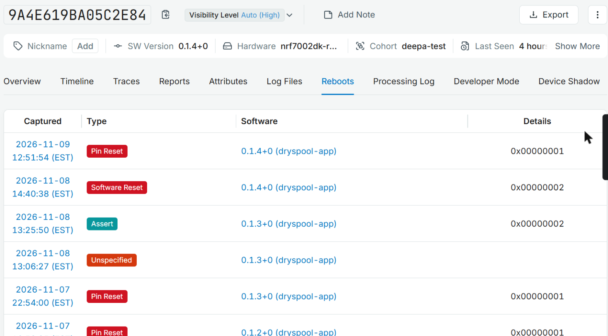
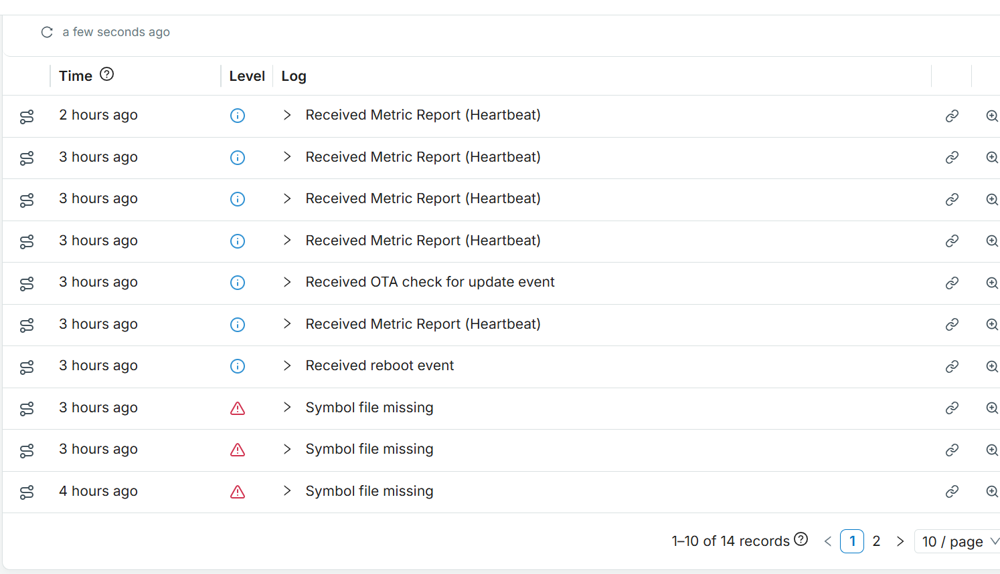
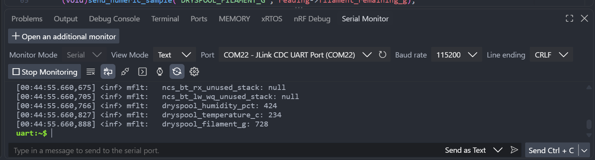

# ESE5180: IoT Venture

**Team Number: T06**

**Team Name: DrySpool**

| Team Member Name | Email Address                |
| ---------------- | ---------------------------- |
| Sirui Wu         | wu40@engineering.upenn.edu   |
| Zicong Zhang     | zhang89@seas.upenn.edu       |
| Deepa Lokesha     | deepasr1@engineering.upenn.edu  |

**GitHub Repository URL:** https://github.com/ese5180/f26-t06-dry-spool

## Team operation links

- [`firmware/README.md`](firmware/README.md): firmware architecture, build,
  memory map, and verified FOTA results.
- [`docs/TEAM_SETUP_AND_DEMO.md`](docs/TEAM_SETUP_AND_DEMO.md): repeatable
  teammate setup, multi-device provisioning, release procedure, and the live
  demo walkthrough.

## Concept Development

### Product Function

DrySpool is a proposed connected filament-storage system that monitors remaining filament and alerts users when supplies run low. It measures temperature and humidity and automatically controls a dehumidification module to reduce moisture in the enclosure. RFID/NFC links spools to inventory records, and a dashboard brings together filament, environment, and device status for makerspace users and staff.

### Target Market & Demographics

- **Users:** Students, makers, and staff sharing 3D printers in university laboratories and makerspaces.
- **Purchasers:** Laboratory or makerspace managers responsible for filament supplies and equipment maintenance.
- **Initial market:** U.S. higher-education printing laboratories and makerspaces, with stakeholder outreach in the Philadelphia area.
- **Market estimate:** An illustrative hardware opportunity of $217,000–650,000, based on [NCES&#39;s 3,633 degree-granting institutions in 2022–23](https://nces.ed.gov/pubs2024/2024144.pdf), an assumed 10%–30% adoption scope, four nodes per site, and a hypothetical 149 per node. The 20% base case is approximately 433,000. These are planning assumptions; site eligibility, demand, and pricing remain unvalidated.
- **Initial sales target:** 10 sites × 4 nodes × $149 = 5,960 after prototype validation and product development; this is a planning target, not committed sales.
- **Competitors:** [SpoolEase](https://www.spoolease.io/docs/full-guide/spool-weight-tracking) addresses filament tracking, and [SpoolSense](https://spoolsense.org/) uses NFC for spool identification. DrySpool proposes combining inventory monitoring, humidity control, and shared-space alerts.

### Stakeholders

| Stakeholder                              | Organization / role                | Feedback focus                                                 |
| ---------------------------------------- | ---------------------------------- | -------------------------------------------------------------- |
| **Tex Kang**                       | **UPenn makerspace contact** | Filament handling, useful alerts, and staff/student workflows. |
| **Hive76 staff member or manager** | **Hive76 commu hackerspace** | Shared inventory, spool identification, and maintenance needs. |

Team-reported conversations indicate interest in remaining-filament alerts, humidity-related functions, and RFID identification. These are preliminary qualitative inputs; prototype feedback and willingness to pay remain to be established.

### System-Level Diagrams

Device system:



Filament path: **Spool in box → PTFE outlet → Printer extruder.** The printer pulls the filament; the spool turns freely.

The fan circulates air through replaceable desiccant to support humidity control. This is a proposed arrangement; final components and enclosure layout remain subject to prototype testing.

Wireless data paths:



### Security Requirements Specification

- **SEC-01:** Devices shall accept only trusted, signed firmware updates and handle failed updates safely.
- **SEC-02:** Private signing keys and service credentials shall remain outside the public repository.
- **SEC-03:** Network services shall use authenticated access and protected communication, including TLS certificate verification for cloud connections.

### Hardware Requirements Specification

Specific components, measurement accuracy, enclosure layout, and control thresholds will be refined through prototype testing.

- **HRS-01:** The system shall use course-compatible Nordic hardware and wireless connectivity, with at least two working devices at MVP and four at final.
- **HRS-02:** The hardware shall support remaining-filament estimation for the selected spool and feeding setup, with calibration and observed accuracy documented.
- **HRS-03:** The system shall measure temperature and humidity and support controlled moisture removal. Environmental sensing and control may be shared across spools where practical.
- **HRS-04:** The hardware shall provide suitable power, compatible interfaces, and external Flash for firmware-update staging.

### Software Requirements Specification

- **SRS-01:** Firmware shall use Zephyr / NCS 3.4.x, and each team member shall be able to build and flash the common project.
- **SRS-02:** The system shall associate readings with the correct spool, support manual identification with planned RFID/NFC assistance, and handle spool replacement and unavailable data clearly.
- **SRS-03:** The system shall display filament, environment, and device status on a dashboard and provide basic local alerts. Thresholds and update intervals may be adjusted during testing.
- **SRS-04:** The system shall control humidity using sensor feedback, handle maintenance and sensor faults, and retain essential local functions during network loss.
- **SRS-05:** The system shall support signed wireless updates and course-required cloud diagnostics, including software versions, core dumps, and critical data. Development shall include peripheral-driver TDD and the required CI checks.

## Wireless and signed FOTA foundation (3.5)

The team uses one common firmware project for the rest of the semester—not a
separate FOTA-only demo. The project-representative application telemetry and
the update path therefore share the same Wi-Fi/cloud connection, configuration,
memory map, and build. See [`firmware/README.md`](firmware/README.md) for setup,
build, onboarding, and checkoff results. Teammates bringing up additional
boards should follow the complete
[`team setup and demo runbook`](docs/TEAM_SETUP_AND_DEMO.md).

### Selected framework

The firmware is based on Nordic Semiconductor's current online
[`samples/wifi/nrf_cloud`](https://github.com/nrfconnect/sdk-nrf/tree/main/samples/wifi/nrf_cloud)
sample, audited at commit `b338f2f8548027612c6a94f9379f39d41cf55c37`, then backported to the
course's NCS 3.4.0 release. This was selected because it already combines the
nRF7002 DK, resilient Wi-Fi connection management, nRF Cloud messages, Memfault
diagnostics, MCUboot, external-flash staging, and Memfault Release Management.

DrySpool replaces the sample's generic temperature/location behavior with a
product interface for:

- enclosure temperature (`DRYSPOOL_TEMPERATURE_C`);
- relative humidity (`DRYSPOOL_HUMIDITY_PCT`);
- estimated remaining filament (`DRYSPOOL_FILAMENT_G`); and
- dehumidifier state (`DRYSPOOL_DEHUMIDIFIER_ON`).

The final sensor and load-cell parts have not yet been selected, so the current
backend deliberately emits deterministic simulated readings. Only
`firmware/src/dryspool_sensors.c` must be replaced when those parts are fixed;
the cloud and FOTA framework is already the full firmware framework.

### Boot and update process



The application—not MCUboot—maintains Wi-Fi, asks Memfault within nRF Cloud for
a Release, and streams the update into slot 1. MCUboot remains small and handles
only validation, swap, test boot, confirmation state, rollback, and transfer to
the application.

### Measured image and memory sizes

These values come from a clean NCS 3.4.0 sysbuild of version `0.1.0` on the
`nrf7002dk/nrf5340/cpuapp/ns` target:

| Region/artifact | Measured use | Allocated capacity | Location |
| --- | ---: | ---: | --- |
| MCUboot | 39,308 B (38.4 KiB) | 64 KiB | nRF5340 internal flash |
| TF-M secure application | 130,008 B (127.0 KiB) | 128 KiB sub-slot | nRF5340 slot 0 |
| DrySpool non-secure application | 727,728 B (710.7 KiB) | 768 KiB sub-slot | nRF5340 slot 0 |
| Complete signed update artifact | 858,951 B (838.8 KiB) | 896 KiB image slot | slot 0 / slot 1 |
| Download staging slot 1 | — | 896 KiB | external MX25R64 flash |
| Memfault coredump | 7,444 B required | 8 KiB | nRF5340 internal flash |
| Settings | — | 8 KiB | nRF5340 internal flash |
| TF-M storage | — | 48 KiB | nRF5340 internal flash |

The non-secure image uses 393,708 B of the 400 KiB application RAM. The external
MX25R64 is 64 Mbit (8 MiB); only an 896 KiB partition is assigned
to the secondary image. The primary and secondary image slots are equal-sized
so MCUboot's swap-using-move mode can exchange them without a scratch partition.

### Download communication choice

The nRF7002 provides 2.4 GHz Wi-Fi, so updates are downloaded via HTTPS over the
same network path the product already needs for its shared makerspace dashboard.
This avoids adding a phone/gateway dependency and gives enough throughput for an
approximately 840 KiB image. DrySpool telemetry uses authenticated nRF Cloud
CoAP/DTLS; NCS 3.4.0's bundled Memfault version uses its supported direct HTTPS
path for diagnostics, release checks, and the payload download.

### Root of trust and failure handling

- The branch uses a uniquely generated team ECDSA-P256 key. MCUboot embeds only
  its public key; the ignored private PEM remains outside Git and is shared only
  through a private team channel.
- MCUboot verifies the SHA-256 hash and ECDSA signature before accepting an
  image. A corrupted payload or an image signed by another key is rejected.
- The downloader writes progressively to external flash; an interrupted or
  failed transfer is not marked pending, so the current image remains bootable.
- A valid new image is first booted in test mode. DrySpool calls image confirm
  only after its product sensor layer initializes; a crash or failed startup
  leaves it unconfirmed, causing MCUboot to restore the known-good image.
- Network messages are queued and retried. Repeated cloud send failures reset
  and re-establish the connection after a cooldown instead of blocking local
  product behavior.
- Memfault records reboot reasons, metrics, faults, and a flash-backed coredump
  to support diagnosis before the next release. The dedicated 8 KiB partition
  preserves the full measured 7,444 B dump without consuming scarce application RAM.

### Verification status

- [x] Common branch and repository structure created.
- [x] Clean NCS 3.4.0 build produces a versioned ECDSA-signed image.
- [x] MCUboot, external slot 1, Memfault FOTA, and rollback configuration are enabled.
- [x] Product-representative DrySpool messages are implemented behind a sensor interface.
- [x] The connected nRF7002 DK was flashed and booted through MCUboot; the app,
  Wi-Fi device, and external MX25R64 all report ready.
- [x] A controlled Memfault fault produced a complete 7,444 B flash-backed
  coredump, survived reboot, and was cleared after verification.
- [x] The DK was provisioned in nRF Cloud, joined Wi-Fi, authenticated over
  CoAP/DTLS, and continuously reported all four DrySpool telemetry values.
- [x] Signed version `0.1.1+0` was deployed to the `default` cohort and
  downloaded from a running `0.1.0+0` image over Wi-Fi/HTTPS. MCUboot booted
  the update in test mode, DrySpool confirmed it, and a second hardware reset
  retained `0.1.1+0` without rollback.
- [x] The updated device posted a 217 B Memfault heartbeat; the cloud then
  reported `dryspool-app` version `0.1.1+0` on `nrf7002dk-rev1`. A subsequent
  latest-release query returned HTTP 204 (no newer release).
- [x] `imgtool` accepted the team-signed `0.1.1+0` image and rejected an
  otherwise identical test image signed by a different ECDSA-P256 key.
- [ ] Each teammate copies the private signing key out of band and independently builds/flashes.
- [x] Provision the connected DK's nRF Cloud credentials and Wi-Fi network.
- [x] Perform the live telemetry and two-version FOTA/rollback checkoff on hardware.

## Fleet management with Memfault (3.11)

Shipped firmware is never perfect: bugs are found and features are added after
devices are in makerspaces. DrySpool therefore uses Memfault, now part of
nRF Cloud (organization `zicong-zhang`, project `default-project`), to roll out
signed updates to selected devices, collect crash reports remotely, and monitor
product data across the fleet. All features below were demonstrated on the
nRF7002 DK with device ID `9A4E619BA05C2E84`.

### Fleet structure

| Concept | DrySpool use |
| --- | --- |
| Software type | `dryspool-app` (`CONFIG_MEMFAULT_NCS_FW_TYPE`) |
| Hardware version | `nrf7002dk-rev1` (`CONFIG_MEMFAULT_NCS_HW_VERSION`) |
| Device ID | Hardware-derived nRF5340 ID, e.g. `9A4E619BA05C2E84` |
| Cohorts | `default` for team boards; `deepa-test` isolates one test board |
| Releases | One OTA release per version, activated per cohort |
| Symbol files | The `zephyr.elf` of every released build, matched by GNU build ID |

Cohorts let a release be tested on one board before it reaches the rest of the
fleet. Activating a release for `deepa-test` updated only that board; the other
boards in `default` kept their versions.

### 1. OTA firmware updates with version info

Each update follows the same path:

1. Increase `PATCHLEVEL` in `firmware/VERSION` and the `APP_VERSION` default in
   `firmware/Kconfig` (both must match, e.g. `0.1.4`).
2. Build with sysbuild; the image is signed with the team ECDSA-P256 key.
   `imgtool verify` must report `Image was correctly validated` and the new version.
3. In nRF Cloud, create release `0.1.4+0`, add `zephyr.signed.bin` as the OTA
   payload for `nrf7002dk-rev1`, and upload the matching `zephyr.elf` to Symbol Files.
4. Create an activation for the target cohort only (`deepa-test`).
5. On the board UART, `mflt get_latest_release` downloads the image over
   Wi-Fi/HTTPS into external slot 1; MCUboot verifies and swaps it, and the
   application confirms it after startup.
6. `mflt get_device_info` reports the new `SW version`, and the release page
   shows 100% device coverage.

Verified sequence on `9A4E619BA05C2E84`: `0.1.2+0` → `0.1.3+0` → `0.1.4+0`.
Each update downloaded about 859 KB, booted in test mode, was confirmed, and
remained installed after a further hardware reset.





### 2. Core dumps

The firmware stores a Memfault coredump in a dedicated 8 KiB internal-flash
partition (`memfault_coredump_partition`, `0xFA000`). After a fault the board
reboots, and the dump is uploaded with the next `mflt post_chunks`. Memfault uses
the uploaded `zephyr.elf` (matched by GNU build ID) to turn addresses into
function names and line numbers.

Test procedure:

```text
mflt test assert      # deliberate software assert; the board reboots
mflt post_chunks      # upload the saved coredump
```

Result: issue **"Assert at memfault_demo_cli_cmd_assert"** on `0.1.3+0`, with
reason *Assert*, the full call path from `shell_process` (`shell.c`) through
`memfault_demo_cli_cmd_assert` to `prv_fault_handling_assert`, the Cortex-M
fault registers (CFSR, HFSR, SHCSR), and a memory view.





### 3. MCU reboot reasons

Every time the nRF5340 restarts, Memfault records *why* it restarted and uploads
it with the next chunks. No application code is needed; it is enabled by the
Memfault NCS integration:

| Setting | Effect |
| --- | --- |
| `CONFIG_MEMFAULT_REBOOT_REASON_GET_HWINFO=y` | At boot, reads the hardware reset cause (nRF5340 `RESETREAS` register) through Zephyr's `hwinfo` driver: pin reset, power-on, watchdog, lockup, and so on |
| Memfault reboot tracking (SDK default) | Before a software-initiated reset (assert, fault, `sys_reboot`, MCUboot swap after OTA), the SDK stores the reason in no-init RAM so it survives the reset |

The board also prints the raw value at startup (`print_reset_reason()` in
`firmware/src/application.c`, e.g. `Reset reason: 0x1`).

Reboots recorded for `9A4E619BA05C2E84`, each tied to the action that caused it:

| Reason in Memfault | Cause during testing |
| --- | --- |
| **Pin Reset** | RESET button on the DK, or a reset from the programmer after flashing |
| **Assert** | `mflt test assert` (the coredump test in section 2) |
| **Software Reset** | Reboot into MCUboot to install an OTA update, or `kernel reboot` |
| **Unspecified** | Reset with no recorded cause (no hardware flag and no saved software reason) |

Unexpected reboots (Assert, faults, watchdog) are also counted in the
`Unexpected Reboot Count` and `operational_crashfree_hours` metrics, so crash
rates can be compared between firmware versions. In the Processing Log each one
appears as *Received reboot event*.



### 4. Metrics

Memfault collects metrics in RAM and sends them as a **heartbeat**: one summary
value per metric per interval. Three groups are reported.

#### 4.1 Power status (battery state of charge)

The nRF7002 DK has no battery: it is always USB powered. To report power status
through Memfault's standard battery metrics, firmware `0.1.6` enables
`CONFIG_MEMFAULT_METRICS_BATTERY_ENABLE=y` (in `firmware/coap.conf`) and
implements the platform hook in `firmware/src/dryspool_power.c`:

```c
int memfault_platform_get_stateofcharge(sMfltPlatformBatterySoc *soc)
{
	soc->soc = 100 * CONFIG_MEMFAULT_METRICS_BATTERY_SOC_PCT_SCALE_VALUE;
	soc->discharging = false; /* USB powered -> never discharging */
	return 0;
}
```

The SDK calls this hook at boot and at every heartbeat and reports
`battery_soc_pct = 100` with *not discharging*. It also reports the discharge
metrics, `battery_soc_pct_drop` and `battery_discharge_duration_ms`; while the
board is on USB those sessions are skipped. In other words, the board reports
"externally powered". This is a **placeholder**: the DrySpool PCB will read a
real fuel gauge in the same function, and nothing else has to change.

Status: `0.1.6` is built and committed (Kconfig confirmed in the build
`.config`); its OTA release was not yet activated at the time of the check-off,
so no `battery_soc_pct` data is shown here.

#### 4.2 Zephyr / NCS default metrics

With `CONFIG_MEMFAULT_METRICS_DEFAULT_SET_ENABLE=y` and
`CONFIG_MEMFAULT_NCS_USE_DEFAULT_METRICS=y`, the SDK adds these to every heartbeat
without any application code:

| Group | Metrics (examples received from the board) | What it tells us |
| --- | --- | --- |
| CPU and uptime | `cpu_usage_pct`, `uptime_s`, `boot_time_ms` | Load, and how long the device takes to become ready |
| Thread stacks | `memory_idle_pct_max`, `memory_sysworkq_pct_max`, `memory_mflt_upload_pct_max`, `ncs_connection_poll_unused_stack`, `ncs_bt_rx_unused_stack`, `ncs_bt_lw_wq_unused_stack` | How close each thread came to overflowing its stack |
| Wi-Fi | `wifi_sta_rssi`, `wifi_tx_rate_mbps`, `wifi_primary_channel`, `wifi_beacon_interval`, `wifi_dtim_interval`, `wifi_twt_capable`, `wifi_connected_time_ms`, `wifi_disconnect_count` | Link quality and stability in the makerspace |
| Connectivity | `connectivity_connected_time_ms`, `connectivity_expected_time_ms` | Share of time the device was online |
| Upload health | `sync_memfault_successful`, `sync_memfault_failure`, `sync_successful`, `sync_failure` | Whether uploads succeed (failures were seen while Wi-Fi was down) |
| Reliability | `operational_hours`, `operational_crashfree_hours`, `Unexpected Reboot Count`, heartbeat `Duration` | Crash-free hours across the fleet |

`CONFIG_MEMFAULT_METRICS_MEMORY_USAGE` (heap usage) is disabled because Memfault
1.40 does not compile against Zephyr 4.4's system heap; thread-stack metrics
remain enabled.

The Processing Log shows the heartbeats arriving as *Received Metric Report
(Heartbeat)*, together with the reboot event and an OTA check:



#### 4.3 Forwarding critical device data

Humidity is DrySpool's most important value: it shows whether stored filament
stays dry. Starting with `0.1.4`, the firmware forwards it, together with
enclosure temperature and remaining filament, as Memfault heartbeat metrics.

`firmware/config/memfault_metrics_heartbeat_config.def`:

```c
MEMFAULT_METRICS_KEY_DEFINE_WITH_SCALE_VALUE(dryspool_humidity_pct, kMemfaultMetricType_Unsigned, 10)
MEMFAULT_METRICS_KEY_DEFINE_WITH_SCALE_VALUE(dryspool_temperature_c, kMemfaultMetricType_Signed, 10)
MEMFAULT_METRICS_KEY_DEFINE(dryspool_filament_g, kMemfaultMetricType_Unsigned)
```

`firmware/src/application.c` updates the metrics on every 60-second sample:

```c
MEMFAULT_METRIC_SET_UNSIGNED(dryspool_humidity_pct,
			     (uint32_t)(reading->humidity_pct * 10.0));
MEMFAULT_METRIC_SET_SIGNED(dryspool_temperature_c,
			   (int32_t)(reading->temperature_c * 10.0));
MEMFAULT_METRIC_SET_UNSIGNED(dryspool_filament_g,
			     (uint32_t)reading->filament_remaining_g);
```

Values are stored ×10 and scaled back by Memfault (for example, 425 → 42.5 %RH).
`firmware/CMakeLists.txt` adds `config/` to the include path so the Memfault SDK
finds the definition file.

Timing (firmware `0.1.6`, set in `firmware/coap.conf`):

| Step | Interval | Setting |
| --- | --- | --- |
| Sensor sample (serial log, nRF Cloud `DRYSPOOL_*` message, metric update) | 60 s | `CONFIG_SENSOR_SAMPLE_INTERVAL_SECONDS` |
| Memfault heartbeat (one data point per metric) | 300 s | `CONFIG_MEMFAULT_METRICS_HEARTBEAT_INTERVAL_SECS=300` |
| Automatic upload to Memfault (and OTA check) | 300 s, once the cloud connection is ready | `CONFIG_MEMFAULT_PERIODIC_UPLOAD_INTERVAL_SECS=300` |

Earlier versions used the Memfault default of one hour for both. A heartbeat
can also be sent on demand with `mflt test heartbeat` followed by
`mflt post_chunks`. The existing nRF Cloud `DRYSPOOL_*` messages are unchanged.

`mflt metrics_dump` on the board shows the values stored for the next heartbeat
(`424` = 42.4 %RH, `234` = 23.4 °C, `728` g of filament):




Fleet-level Metric Charts (*DrySpool Humidity (%RH)*, *Temperature*, *Filament
Remaining*) were added to the Metrics dashboard; they display percentiles once
more devices report the new metrics.

### 5. Firmware comprehension

The firmware is based on the NCS `samples/wifi/nrf_cloud` sample (CoAP variant)
with the DrySpool application and Memfault added. It runs as separate Zephyr
threads, started in `firmware/src/main.c` with `K_THREAD_DEFINE`:

| Thread | Function (file) | Job |
| --- | --- | --- |
| `con_thread` | `cloud_connection_thread_fn` (`cloud_connection.c`) | Connects Wi-Fi, then nRF Cloud over CoAP/DTLS; reconnects on loss; enables Memfault uploads in `cloud_ready()` |
| `app_thread` | `main_application_thread_fn` (`application.c`) | Prints the reset reason, initializes sensors, confirms an OTA image, waits for the cloud, then samples every 60 s |
| `msg_thread` | `message_queue_thread_fn` (`message_queue.c`) | Sends queued messages to nRF Cloud |
| `coap_shadow` | `coap_shadow_thread_fn` (`shadow_support_coap.c`) | Syncs the device shadow (configuration) |
| `led_thread` | `led_animation_thread_fn` (`led_control.c`) | Status LEDs |
| Memfault upload workqueue | SDK (`memfault_periodic_upload.c`) | Every 300 s: posts chunks to Memfault and checks for OTA |

**One sensor sample takes two routes to the cloud:**

```text
dryspool_sensors_read()                         application.c, every 60 s
  └─ send_dryspool_sample()
       ├─ LOG_INF("DrySpool: ...")                -> serial monitor (local only)
       ├─ Route A: send_numeric_sample("DRYSPOOL_HUMIDITY_PCT", ...)
       │     └─ send_device_message()  -> k_msgq      message_queue.c
       │          └─ nrf_cloud_coap_obj_send()  -> nRF Cloud (CoAP/DTLS, UDP)
       │                                            raw value every 60 s
       └─ Route B: MEMFAULT_METRIC_SET_UNSIGNED(dryspool_humidity_pct, ...)
             └─ stored in RAM; every 300 s the SDK closes a heartbeat,
                packs it into chunks, and posts them over HTTPS
                -> Memfault: one summary value per heartbeat
```

| | Route A: nRF Cloud messages | Route B: Memfault |
| --- | --- | --- |
| Purpose | Product data (current humidity of a box) | Fleet health (crashes, reboots, metrics, OTA) |
| Code | Team code (`application.c`, `message_queue.c`) | Memfault SDK, fed by `MEMFAULT_METRIC_SET_*` and configured with Kconfig |
| Rate | Every 60 s | Heartbeat and upload every 300 s (`0.1.6`) |
| Transport | CoAP over DTLS (UDP) | HTTPS (TCP) |
| Where to view | Legacy nRF Cloud → device → Terminal (d2c) | Memfault → device → Timeline, Reboots, Issues |

**Memfault data path on the device:**

1. *Collect.* Metrics live in RAM; coredumps go to the 8 KiB flash partition at
   `0xFA000`; reboot reasons are captured at boot (section 3).
2. *Heartbeat.* `CONFIG_MEMFAULT_METRICS_HEARTBEAT_INTERVAL_SECS=300` closes the
   interval and serializes all metrics.
3. *Chunks.* The packetizer splits heartbeats, reboot events and coredumps into
   chunks.
4. *Upload.* `CONFIG_MEMFAULT_PERIODIC_UPLOAD_INTERVAL_SECS=300` posts the chunks
   over HTTPS. Uploads start only after `cloud_ready()` calls
   `memfault_zephyr_port_periodic_upload_enable(true)`
   (`CONFIG_MEMFAULT_PERIODIC_UPLOAD_ENABLED_DEFAULT=n`), so they do not race
   Wi-Fi at boot. `mflt post_chunks` does the same on demand.
5. *Decode.* Memfault matches the GNU build ID to the uploaded `zephyr.elf`;
   without it, data is held with *Symbol file missing* (seen before the `0.1.4`
   symbols were uploaded).

**OTA path:** the periodic upload task checks for a release for this device's
cohort. If one exists, the image is downloaded over HTTPS into external-flash
slot 1, MCUboot verifies the ECDSA-P256 signature and swaps it in (test mode),
and `memfault_fota_support_init()` confirms it after the sensor layer starts.
If the new image fails before confirmation, MCUboot reverts to the previous one.

**Configuration files:**

| File | Role |
| --- | --- |
| `firmware/prj.conf` | Base Wi-Fi, nRF Cloud, and logging configuration |
| `firmware/coap.conf` | CoAP transport and all Memfault settings (intervals, battery, coredump, shell) |
| `firmware/coap-fota.conf` | FOTA support (`CONFIG_SAMPLE_MEMFAULT_FOTA`) |
| `firmware/local.conf` | Project key only; git-ignored |
| `firmware/config/memfault_metrics_heartbeat_config.def` | Custom DrySpool metrics |
| `firmware/VERSION`, `firmware/Kconfig` | Version (`0.1.6`), used by MCUboot and by Memfault |

### 6. Extra credit

Not yet implemented. Candidates: a staged rollout (activating a release for a
percentage of a cohort) once a second board runs `0.1.4`.

### Verification status

- [x] OTA `0.1.2+0` → `0.1.3+0` → `0.1.4+0` on `9A4E619BA05C2E84` through cohort
  `deepa-test`; each update was confirmed and survived a hardware reset.
- [x] Release coverage reached 100% (1 of 1) for the target cohort while the
  other boards in `default` were unaffected.
- [x] Deliberate assert captured as a flash-backed coredump, uploaded, and
  symbolicated in Memfault Issues.
- [x] Reboot reasons (Pin Reset, Assert, Software Reset) recorded and shown
  in the device Reboots tab.
- [x] Zephyr/NCS default metrics and DrySpool metrics received as heartbeats
  (Processing Log: *Received Metric Report (Heartbeat)*).
- [x] Humidity, temperature, and remaining filament are recorded as Memfault
  heartbeat metrics (`mflt metrics_dump`) and appear in Memfault's metric list.
- [x] Power-status metric implemented and built in `0.1.6`.
- [ ] `0.1.6` OTA release activated, and `battery_soc_pct` visible in Memfault.
- [ ] Second team board running `0.1.4+0` for the MVP demo.
- [ ] Extra-credit feature (e.g. staged rollout).

### Notes for teammates

- Provision each board with `--id-str "<Device ID from the boot log>"` so its
  certificate matches the hardware ID used by the firmware; add `--delete` when
  re-provisioning a board.
- Upload the `.elf` of every released build; without it, crashes show
  "Symbols Missing".
- Activate a new release for the test cohort (`deepa-test`) first; activate it
  for `default` only after it has been confirmed on the test board.
