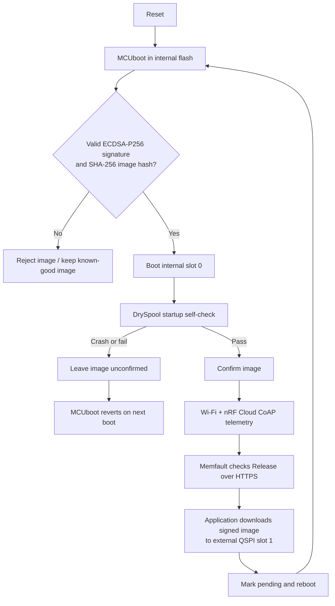

# ESE5180: IoT Venture

**Team Number: T06**

**Team Name: DrySpool**

| Team Member Name | Email Address                |
| ---------------- | ---------------------------- |
| Sirui Wu         | wu40@engineering.upenn.edu   |
| Zicong Zhang     | zhang89@seas.upenn.edu       |
| Deepa Lokesha     | deepasr1@engineering.upenn.edu  |

**GitHub Repository URL:** https://github.com/ese5180/f26-t06-dry-spool

## Concept Development

### Product Function

DrySpool is a proposed connected filament-storage system that monitors remaining filament and alerts users when supplies run low. It measures temperature and humidity and automatically controls a dehumidification module to reduce moisture in the enclosure. RFID/NFC links spools to inventory records, and a dashboard brings together filament, environment, and device status for makerspace users and staff.

### Target Market & Demographics

- **Users:** Students, makers, and staff sharing 3D printers in university laboratories and makerspaces.
- **Purchasers:** Laboratory or makerspace managers responsible for filament supplies and equipment maintenance.
- **Initial market:** U.S. higher-education printing laboratories and makerspaces, with stakeholder outreach in the Philadelphia area.
- **Market estimate:** An illustrative hardware opportunity of $217,000–650,000, based on [NCES&#39;s 3,633 degree-granting institutions in 2022–23](https://nces.ed.gov/pubs2024/2024144.pdf), an assumed 10%–30% adoption scope, four nodes per site, and a hypothetical 149 per node. The 20% base case is approximately 433,000. These are planning assumptions; site eligibility, demand, and pricing remain unvalidated.
- **Initial sales target:** 10 sites × 4 nodes × $149 = 5,960 after prototype validation and product development; this is a planning target, not committed sales.
- **Competitors:** [SpoolEase](https://www.spoolease.io/docs/full-guide/spool-weight-tracking) addresses filament tracking, and [SpoolSense](https://spoolsense.org/) uses NFC for spool identification. DrySpool proposes combining inventory monitoring, humidity control, and shared-space alerts.

### Stakeholders

| Stakeholder                              | Organization / role                | Feedback focus                                                 |
| ---------------------------------------- | ---------------------------------- | -------------------------------------------------------------- |
| **Tex Kang**                       | **UPenn makerspace contact** | Filament handling, useful alerts, and staff/student workflows. |
| **Hive76 staff member or manager** | **Hive76 commu hackerspace** | Shared inventory, spool identification, and maintenance needs. |

Team-reported conversations indicate interest in remaining-filament alerts, humidity-related functions, and RFID identification. These are preliminary qualitative inputs; prototype feedback and willingness to pay remain to be established.

### System-Level Diagrams

Device system:

Filament path: **Spool in box → PTFE outlet → Printer extruder.** The printer pulls the filament; the spool turns freely.

The fan circulates air through replaceable desiccant to support humidity control. This is a proposed arrangement; final components and enclosure layout remain subject to prototype testing.

Wireless data paths:

### Security Requirements Specification

- **SEC-01:** Devices shall accept only trusted, signed firmware updates and handle failed updates safely.
- **SEC-02:** Private signing keys and service credentials shall remain outside the public repository.
- **SEC-03:** Network services shall use authenticated access and protected communication, including TLS certificate verification for cloud connections.

### Hardware Requirements Specification

Specific components, measurement accuracy, enclosure layout, and control thresholds will be refined through prototype testing.

- **HRS-01:** The system shall use course-compatible Nordic hardware and wireless connectivity, with at least two working devices at MVP and four at final.
- **HRS-02:** The hardware shall support remaining-filament estimation for the selected spool and feeding setup, with calibration and observed accuracy documented.
- **HRS-03:** The system shall measure temperature and humidity and support controlled moisture removal. Environmental sensing and control may be shared across spools where practical.
- **HRS-04:** The hardware shall provide suitable power, compatible interfaces, and external Flash for firmware-update staging.

### Software Requirements Specification

- **SRS-01:** Firmware shall use Zephyr / NCS 3.4.x, and each team member shall be able to build and flash the common project.
- **SRS-02:** The system shall associate readings with the correct spool, support manual identification with planned RFID/NFC assistance, and handle spool replacement and unavailable data clearly.
- **SRS-03:** The system shall display filament, environment, and device status on a dashboard and provide basic local alerts. Thresholds and update intervals may be adjusted during testing.
- **SRS-04:** The system shall control humidity using sensor feedback, handle maintenance and sensor faults, and retain essential local functions during network loss.
- **SRS-05:** The system shall support signed wireless updates and course-required cloud diagnostics, including software versions, core dumps, and critical data. Development shall include peripheral-driver TDD and the required CI checks.

## Wireless and signed FOTA foundation (3.5)

The team uses one common firmware project for the rest of the semester—not a
separate FOTA-only demo. The project-representative application telemetry and
the update path therefore share the same Wi-Fi/cloud connection, configuration,
memory map, and build. See [`firmware/README.md`](firmware/README.md) for setup,
build, onboarding, and checkoff steps.

### Selected framework

The firmware is based on Nordic Semiconductor's current online
[`samples/wifi/nrf_cloud`](https://github.com/nrfconnect/sdk-nrf/tree/main/samples/wifi/nrf_cloud)
sample, audited at commit `b338f2f8548027612c6a94f9379f39d41cf55c37`, then backported to the
course's NCS 3.4.0 release. This was selected because it already combines the
nRF7002 DK, resilient Wi-Fi connection management, nRF Cloud messages, Memfault
diagnostics, MCUboot, external-flash staging, and Memfault Release Management.

DrySpool replaces the sample's generic temperature/location behavior with a
product interface for:

- enclosure temperature (`DRYSPOOL_TEMPERATURE_C`);
- relative humidity (`DRYSPOOL_HUMIDITY_PCT`);
- estimated remaining filament (`DRYSPOOL_FILAMENT_G`); and
- dehumidifier state (`DRYSPOOL_DEHUMIDIFIER_ON`).

The final sensor and load-cell parts have not yet been selected, so the current
backend deliberately emits deterministic simulated readings. Only
`firmware/src/dryspool_sensors.c` must be replaced when those parts are fixed;
the cloud and FOTA framework is already the full firmware framework.

### Boot and update process

The application—not MCUboot—maintains Wi-Fi, asks Memfault within nRF Cloud for
a Release, and streams the update into slot 1. MCUboot remains small and handles
only validation, swap, test boot, confirmation state, rollback, and transfer to
the application.

### Measured image and memory sizes

These values come from a clean NCS 3.4.0 sysbuild of version `0.1.0` on the
`nrf7002dk/nrf5340/cpuapp/ns` target:

| Region/artifact | Measured use | Allocated capacity | Location |
| --- | ---: | ---: | --- |
| MCUboot | 39,308 B (38.4 KiB) | 64 KiB | nRF5340 internal flash |
| TF-M secure application | 130,008 B (127.0 KiB) | 128 KiB sub-slot | nRF5340 slot 0 |
| DrySpool non-secure application | 727,728 B (710.7 KiB) | 768 KiB sub-slot | nRF5340 slot 0 |
| Complete signed update artifact | 858,951 B (838.8 KiB) | 896 KiB image slot | slot 0 / slot 1 |
| Download staging slot 1 | — | 896 KiB | external MX25R64 flash |
| Memfault coredump | 7,444 B required | 8 KiB | nRF5340 internal flash |
| Settings | — | 8 KiB | nRF5340 internal flash |
| TF-M storage | — | 48 KiB | nRF5340 internal flash |

The non-secure image uses 393,708 B of the 400 KiB application RAM. The external
MX25R64 is 64 Mbit (8 MiB); only an 896 KiB partition is assigned
to the secondary image. The primary and secondary image slots are equal-sized
so MCUboot's swap-using-move mode can exchange them without a scratch partition.

### Download communication choice

The nRF7002 provides 2.4 GHz Wi-Fi, so updates are downloaded via HTTPS over the
same network path the product already needs for its shared makerspace dashboard.
This avoids adding a phone/gateway dependency and gives enough throughput for an
approximately 840 KiB image. DrySpool telemetry uses authenticated nRF Cloud
CoAP/DTLS; NCS 3.4.0's bundled Memfault version uses its supported direct HTTPS
path for diagnostics, release checks, and the payload download.

### Root of trust and failure handling

- The branch uses a uniquely generated team ECDSA-P256 key. MCUboot embeds only
  its public key; the ignored private PEM remains outside Git and is shared only
  through a private team channel.
- MCUboot verifies the SHA-256 hash and ECDSA signature before accepting an
  image. A corrupted payload or an image signed by another key is rejected.
- The downloader writes progressively to external flash; an interrupted or
  failed transfer is not marked pending, so the current image remains bootable.
- A valid new image is first booted in test mode. DrySpool calls image confirm
  only after its product sensor layer initializes; a crash or failed startup
  leaves it unconfirmed, causing MCUboot to restore the known-good image.
- Network messages are queued and retried. Repeated cloud send failures reset
  and re-establish the connection after a cooldown instead of blocking local
  product behavior.
- Memfault records reboot reasons, metrics, faults, and a flash-backed coredump
  to support diagnosis before the next release. The dedicated 8 KiB partition
  preserves the full measured 7,444 B dump without consuming scarce application RAM.

### Verification status

- [x] Common branch and repository structure created.
- [x] Clean NCS 3.4.0 build produces a versioned ECDSA-signed image.
- [x] MCUboot, external slot 1, Memfault FOTA, and rollback configuration are enabled.
- [x] Product-representative DrySpool messages are implemented behind a sensor interface.
- [x] The connected nRF7002 DK was flashed and booted through MCUboot; the app,
  Wi-Fi device, and external MX25R64 all report ready.
- [x] A controlled Memfault fault produced a complete 7,444 B flash-backed
  coredump, survived reboot, and was cleared after verification.
- [x] The DK was provisioned in nRF Cloud, joined Wi-Fi, authenticated over
  CoAP/DTLS, and continuously reported all four DrySpool telemetry values.
- [x] Signed version `0.1.1+0` was deployed to the `default` cohort and
  downloaded from a running `0.1.0+0` image over Wi-Fi/HTTPS. MCUboot booted
  the update in test mode, DrySpool confirmed it, and a second hardware reset
  retained `0.1.1+0` without rollback.
- [x] The updated device posted a 217 B Memfault heartbeat; the cloud then
  reported `dryspool-app` version `0.1.1+0` on `nrf7002dk-rev1`. A subsequent
  latest-release query returned HTTP 204 (no newer release).
- [x] `imgtool` accepted the team-signed `0.1.1+0` image and rejected an
  otherwise identical test image signed by a different ECDSA-P256 key.
- [ ] Each teammate copies the private signing key out of band and independently builds/flashes.
- [x] Provision the connected DK's nRF Cloud credentials and Wi-Fi network.
- [x] Perform the live telemetry and two-version FOTA/rollback checkoff on hardware.
