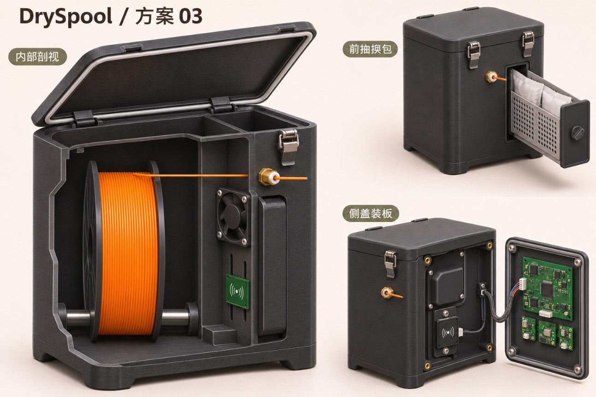

# DrySpool Enclosure

Status: **concept stage (Concept 03)**. CAD is done in SOLIDWORKS 2026; no part has been released for printing yet.

- CAD repository: [zhang89-spec/dryspool-casework](https://github.com/zhang89-spec/dryspool-casework) (private, team access)
- Roles: **Zicong Zhang** – CAD and design; **Deepa** – test prints, fit checks, sealing/humidity tests and assembly

*Concept render (not a CAD screenshot). Left: internal cutaway. Top right: front pull-out desiccant drawer. Bottom right: side cover that doubles as the electronics tray.*

## Design summary

| Part | Design |
| --- | --- |
| Box | Black ASA, printed in several pieces (each ≤ 250 mm) and joined; assembled box may exceed 250 mm |
| Top lid | Two hinges at the back, two latches at the front, gasket in a groove around the rim |
| Spool compartment | Sealed on all four sides; the fan circulates air from the spool compartment through the desiccant and back (closed loop) |
| Desiccant drawer | Front pull-out drawer holding two desiccant packs, with its own sealed cover and knob lock |
| Electronics | Side cover doubles as the board tray (nRF7002 DK, BME280, NAU7802, NFC); removed with four captive screws so boards can be serviced on a desk |
| Weighing | Two Adafruit 4541 load cells under a floating platform; two free-spinning rollers carry the spool so it can turn while being weighed; overload and side stops |
| NFC | Reader in its own zone behind a thin plastic wall, away from metal inserts and the fan motor |
| Fan | 40 mm fan on a reinforced flange (32 mm hole spacing) |
| Filament exit | PC4-M6 push-fit fitting; filament leaves through a PTFE tube along the unwinding direction to reduce pull on the scale |
| Power | External 5 V 4 A DC adapter (Adafruit 1466) into a DC barrel jack (Adafruit 368) on the box wall |
| Heating | None in version 1 (fan + desiccant drying only) |

## Electronics inside the enclosure

- **nRF7002 DK** – main board (Wi-Fi, firmware, cloud)
- **BME280** (Adafruit 2652, STEMMA QT) – temperature and humidity, I2C 0x76
- **NAU7802** – 24-bit load-cell ADC with built-in amplifier, I2C 0x2A; one board reads the two load cells
- **40 mm fan** – air circulation through the desiccant
- **NFC reader** – spool identification

## Open items

- Measure the spool (outer diameter, width, center hole, full weight)
- Update the DC jack mounting in the next CAD version
- Fit the PC4-M6 fitting once the reordered parts arrive
- Confirm how the two load cells are wired to the single NAU7802 (firmware currently reads one channel)

## Test-print log

| Date | Part / test piece | Revision | Result | Notes |
| --- | --- | --- | --- | --- |
|  |  |  |  |  |

Print service turnaround is 2–5 days, so small test pieces (hole fits, load-cell mount, lid seal) are printed before the full enclosure.
